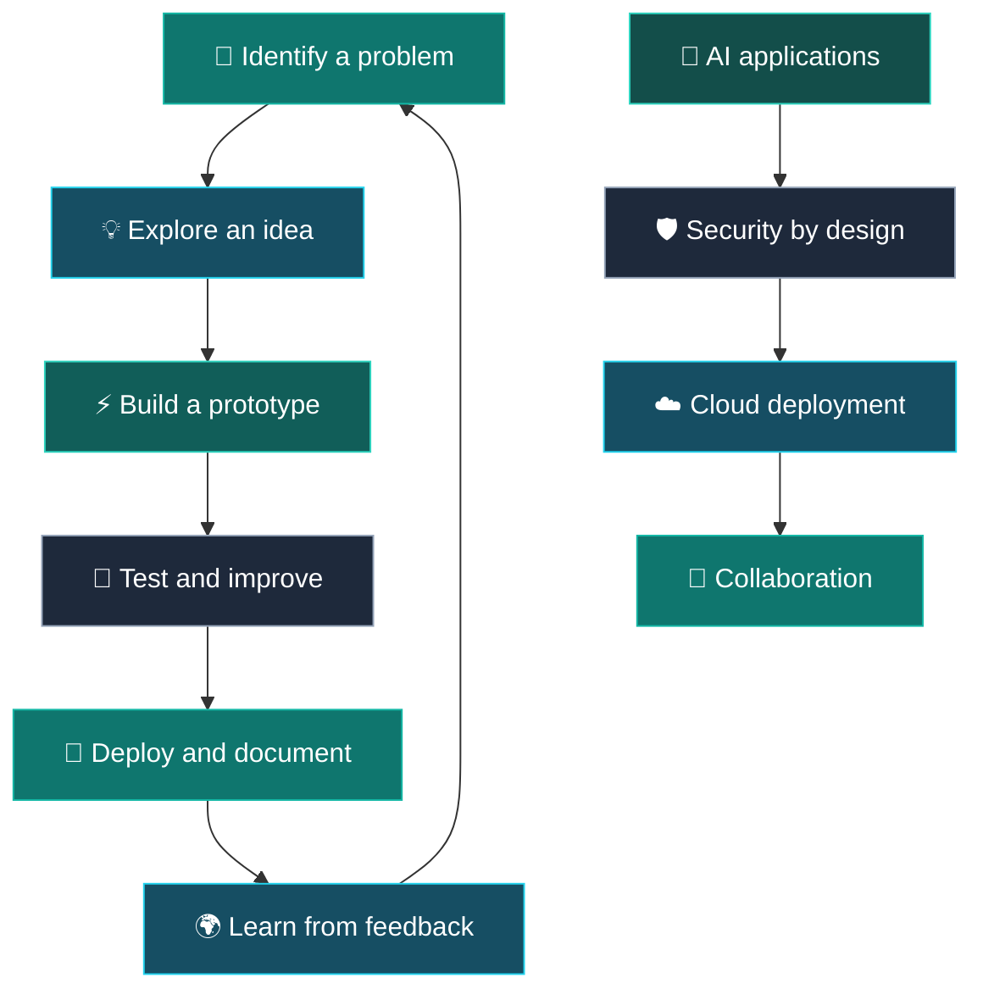

<div align="center">


[](https://ayush-portfolio-eta-two.vercel.app/)
[](https://linkedin.com/in/ayush-maurya-93a91b288/)
[](https://github.com/Ayushmaurya01)

[](https://git.io/typing-svg)

</div>

---

## 👨‍💻 About Me

```python
class AyushMaurya:
    def __init__(self):
        self.role = "B.Tech CSE Student"
        self.interests = [
            "AI Engineering",
            "Cybersecurity",
            "Cloud Computing",
            "Software Development"
        ]
        self.current_focus = [
            "Building practical AI applications",
            "C++ and Data Structures & Algorithms",
            "HTTP, REST APIs, and web security",
            "Cloud deployment and developer tooling"
        ]

    def mindset(self):
        return "Learn by building. Improve with every iteration."

me = AyushMaurya()
print(me.mindset())
```

<table>
<tr>
<td width="50%" valign="top">

### 💬 Code & Curiosity

- 🔭 Building projects that turn ideas into usable prototypes
- 🌱 Currently strengthening C++, DSA, APIs, and security fundamentals
- 🤖 Interested in practical AI applications and AI-assisted development
- ☁️ Exploring cloud services and deployment workflows
- 🤝 Open to learning and collaborating on meaningful projects

</td>
<td width="50%" valign="top">

### 🎞️ My Visual Vibe

<a href="https://ayush-portfolio-eta-two.vercel.app/">

</a>

**My approach:** experiment, build, document, and keep improving.

</td>
</tr>
</table>

## 🚀 Featured Projects

<table>
<tr>
<td width="50%" valign="top">

### 🌱 CarbonMind AI

An AI-focused project exploring technology-driven approaches to environmental sustainability.

[](https://github.com/Ayushmaurya01/carbonMind-AI)
[](https://carbonmind-ai-263028233341.us-central1.run.app/)

</td>
<td width="50%" valign="top">

### 🚀 ShipIt AI

A capstone project focused on turning an idea into a working application through hands-on development.

[](https://github.com/Ayushmaurya01/shipit-ai)

</td>
</tr>
<tr>
<td width="50%" valign="top">

### 🧭 The Local Guide

A web project built with JavaScript, CSS, and HTML as part of a developer challenge.

[](https://github.com/Ayushmaurya01/kiro-week5-local-guide)

</td>
<td width="50%" valign="top">

### 📂 Smart Download Organizer

A Python utility project focused on organizing downloaded files and streamlining a daily workflow.

[](https://github.com/Ayushmaurya01/Smart-Downloads-Organizer)

</td>
</tr>
<tr>
<td width="50%" valign="top">

### 🐍 AI Snake — Retro Revival

A browser-based take on the classic Snake game, built with JavaScript, CSS, and HTML.

[](https://github.com/Ayushmaurya01/kiro-week4-retro-revival)

</td>
<td width="50%" valign="top">

### 💡 What I like building

AI-powered tools, useful web apps, workflow automation, and prototypes that solve a clear problem.

</td>
</tr>
</table>

## 🏆 Achievements & Experience

<p>


</p>

- **Smart India Hackathon 2025** — participated in problem-solving and prototype development.
- **AWS AI for Bharat / Kiro challenges** — explored AI-assisted development through hands-on project challenges.
- **Project-based learning** — building, deploying, and documenting projects while learning new tools.

## 🧰 Skills Matrix

| Area | Technologies & focus |
|---|---|
| **Programming** | C · C++ · Python · Java · JavaScript · TypeScript |
| **Web** | HTML · CSS · JavaScript · REST API fundamentals |
| **Data** | MySQL · MongoDB · SQLite |
| **Cloud** | AWS · Google Cloud · application deployment |
| **Tools** | Git · GitHub · VS Code · Vercel · Render |
| **Currently learning** | DSA · HTTP/API security · authentication · cybersecurity fundamentals |

<details>
<summary><b>🧩 More technologies from my toolkit</b></summary>
<br>


</details>

## 📈 Coding Activity

<div align="center">

[](https://github.com/Ayushmaurya01)

[](https://github.com/Ayushmaurya01)

</div>

## 🐍 Contribution Snake

<div align="center">

<!-- The snake animation is generated by the GitHub Actions workflow in .github/workflows/snake.yml -->
<picture>
  <source media="(prefers-color-scheme: dark)" srcset="https://raw.githubusercontent.com/Ayushmaurya01/Ayushmaurya01/output/github-contribution-grid-snake-dark.svg" />
  <source media="(prefers-color-scheme: light)" srcset="https://raw.githubusercontent.com/Ayushmaurya01/Ayushmaurya01/output/github-contribution-grid-snake.svg" />
  
</picture>

*Every contribution is another step forward.*

</div>

> **Setup note:** GitHub needs to generate this animation before it appears. Add the workflow file provided with this README to `.github/workflows/snake.yml`, then run the **Generate Snake** workflow once from the Actions tab. The workflow publishes the SVG to the `output` branch.

## 🎛️ Live Innovation Control Panel



## 💡 A Thought I Build By

<div align="center">

> “Great things are done by a series of small things brought together.”

— Vincent van Gogh

</div>

## 🏅 Open-Source Snapshot

<div align="center">

[](https://github.com/Ayushmaurya01)


</div>

## 🤝 Let's Connect

<div align="center">

[](https://ayush-portfolio-eta-two.vercel.app/)
[](https://linkedin.com/in/ayush-maurya-93a91b288/)
[](https://instagram.com/the_ayush_maurya__/)
[](mailto:mauryaayush631@gmail.com)
[](https://github.com/Ayushmaurya01)

</div>

---

<div align="center">


<sub>Build with curiosity · Learn by doing · Improve with every project</sub>

</div>
